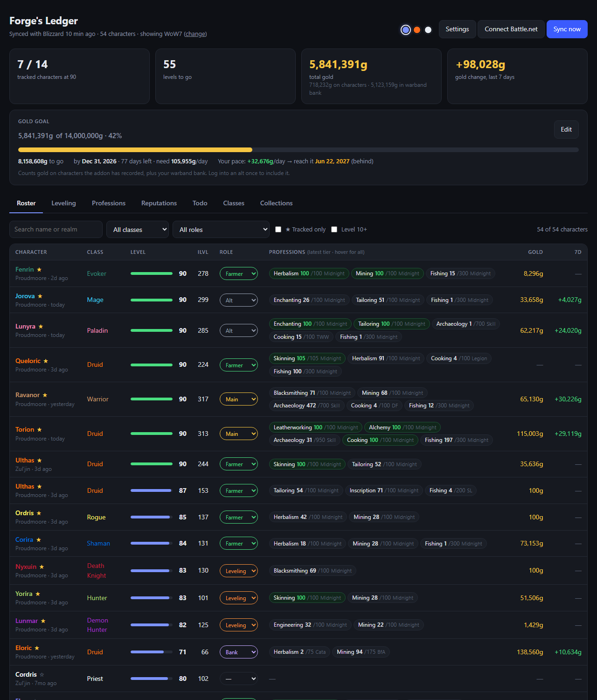
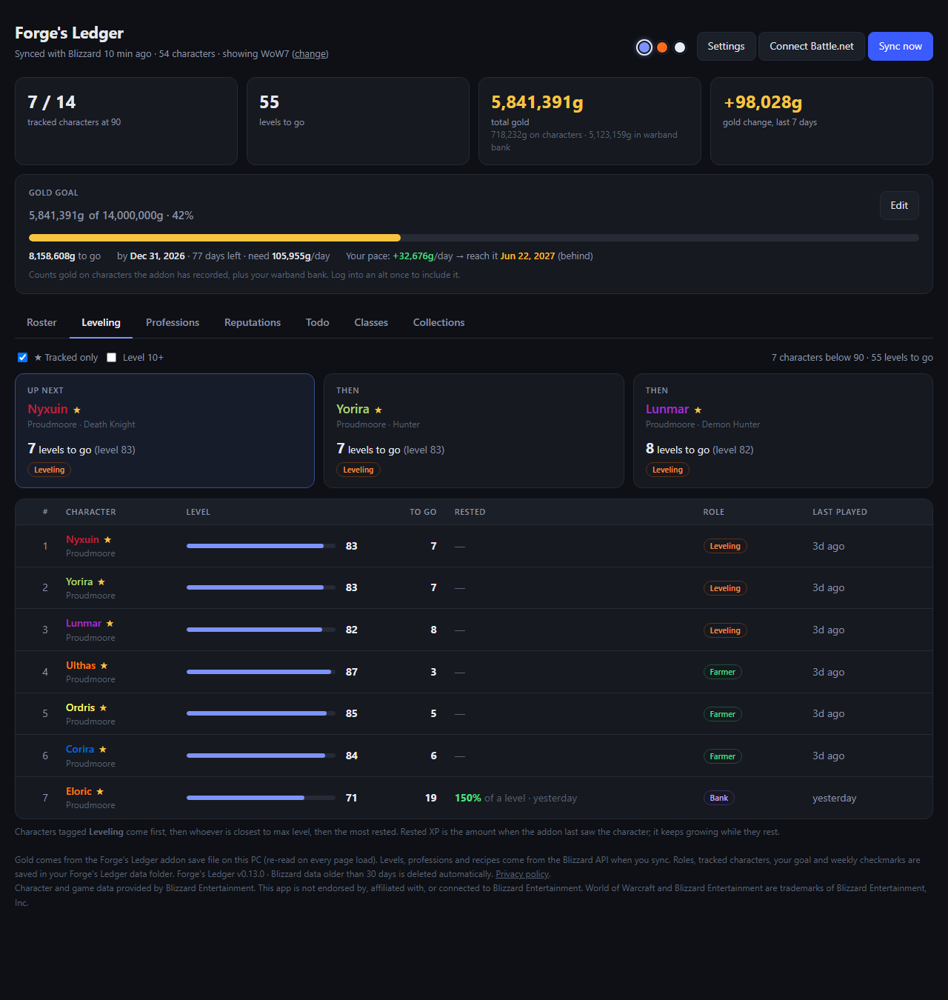
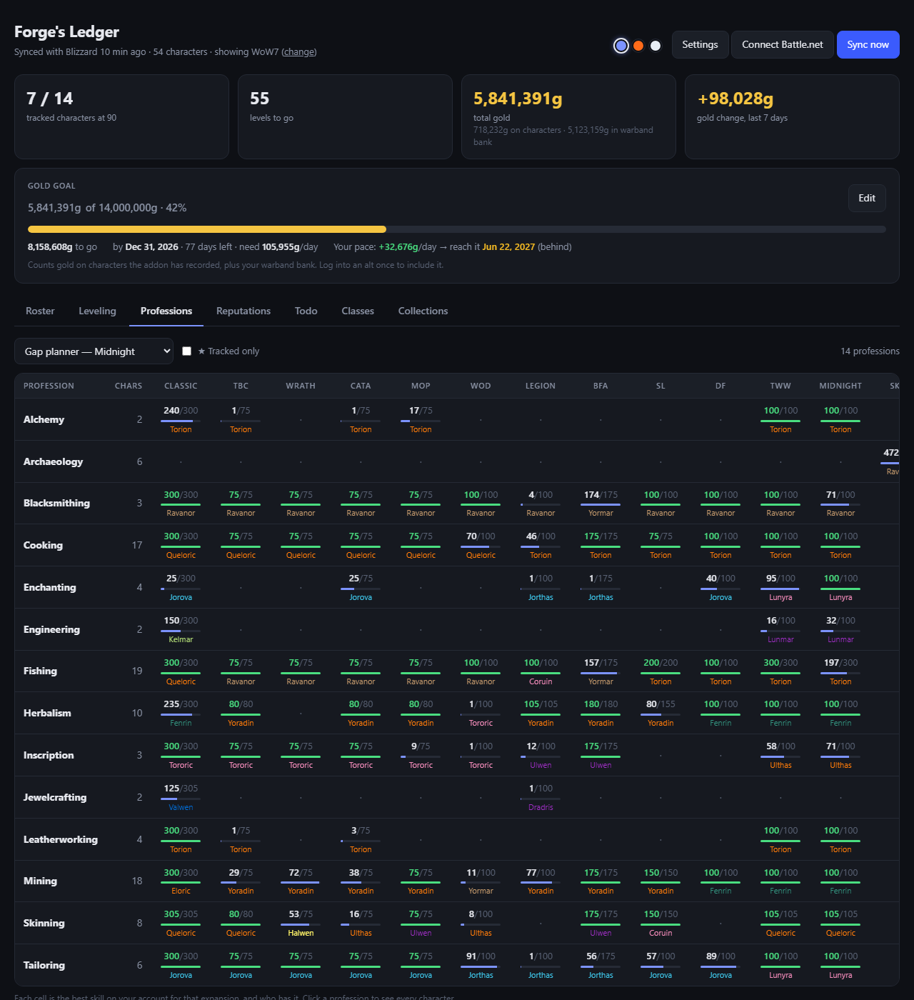
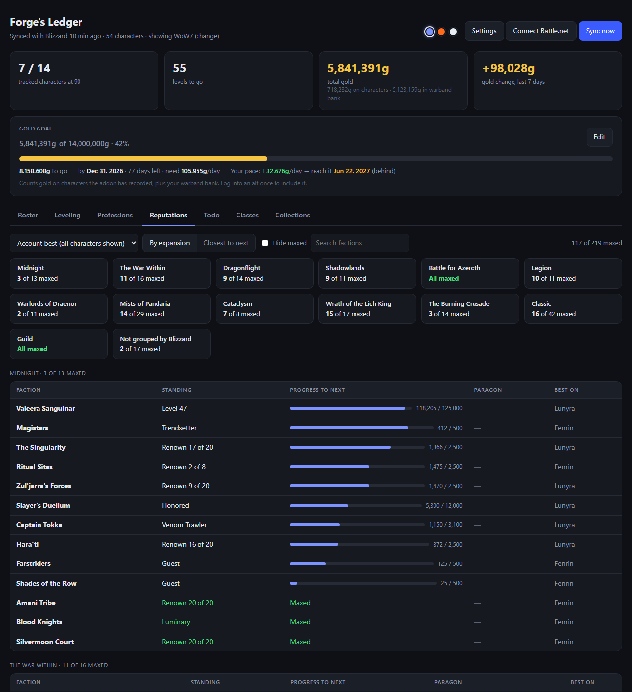
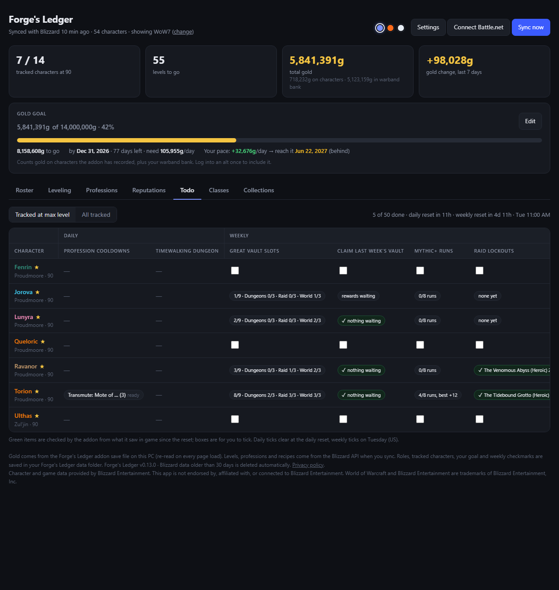
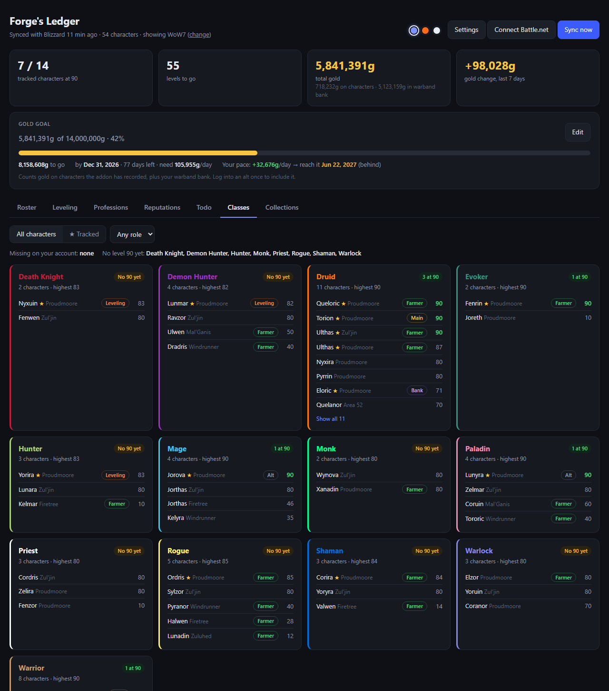
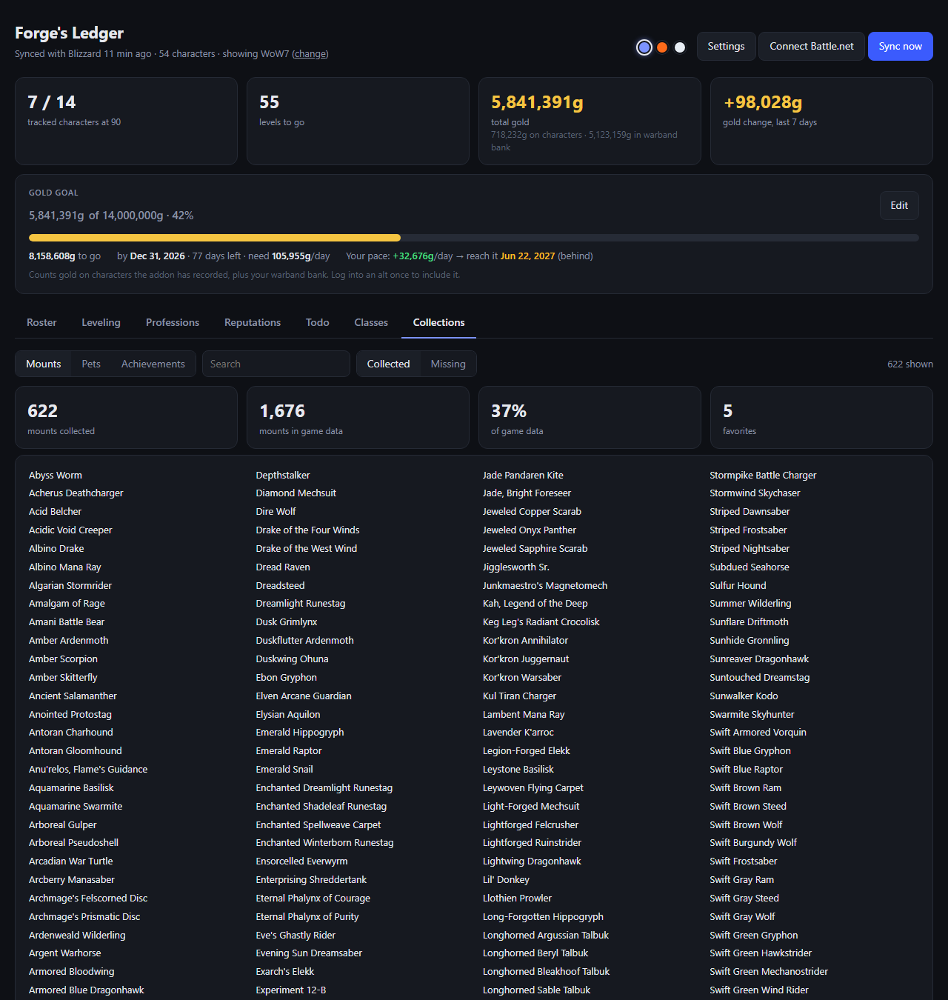
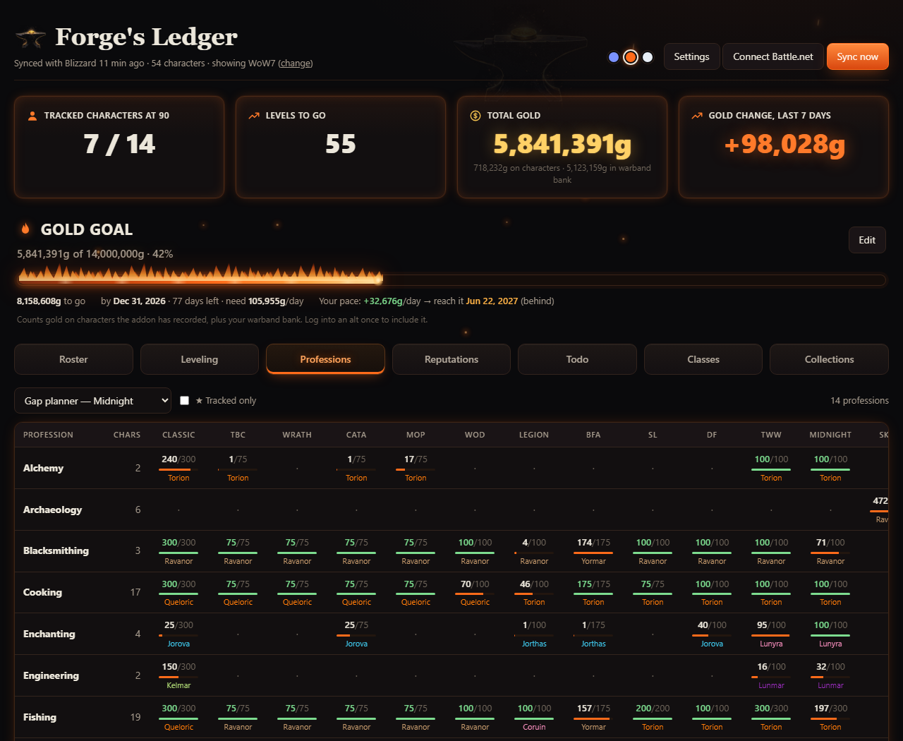
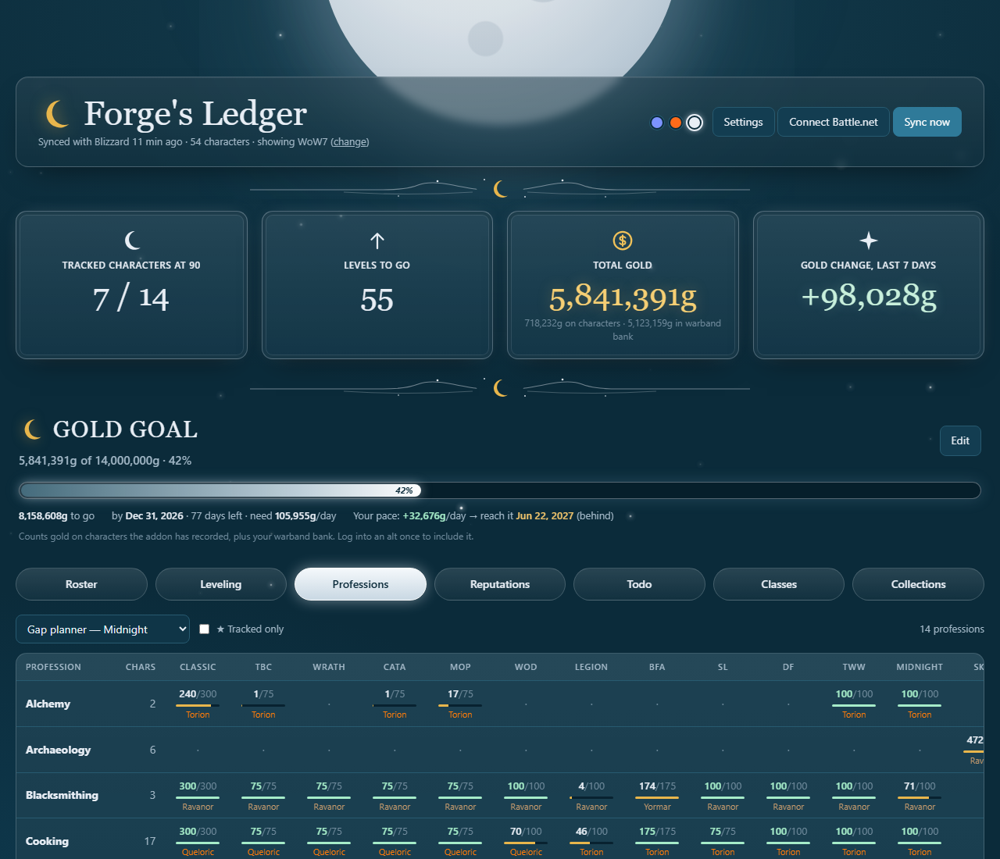

# Forge's Ledger

A desktop dashboard for World of Warcraft players that tracks every character
on your account in one place: levels, professions across every expansion,
known and missing recipes, class coverage, mounts, pets, achievements, and
gold — with a gold goal to work toward.

Everything runs on your own PC. There are no servers, no analytics, and no
tracking. See [PRIVACY.md](PRIVACY.md).

## Features

**Roster** — every character with level, item level, last played, role tags
(Main, Farmer, Crafter, Bank, Leveling, Alt), professions, and gold. Star (☆)
the characters you want to track. The top of every tab shows your total gold
(characters + warband bank) and your gold goal, with the daily target and
projected finish date.



**Leveling** — "who do I play tonight": every character below max level,
ranked with Leveling-tagged characters first, then fewest levels to go, then
most rested.



**Professions** — your best skill in every profession for each expansion
(Classic through Midnight) and who has it, at a glance. Click a profession to
see every character's skill, the recipes each one knows and the ones they're
missing. The **gap planner** lists every character × profession pair that
isn't maxed yet, Crafter-tagged characters first.



**Reputations** — every reputation grouped by expansion, with how many are
maxed in each (Exalted, a friendship's top rank, or the last Renown level),
paragon progress, a "closest to next level" view, and "hide maxed". Shows your
best standing across the account, or one character's.



**Todo** — daily and weekly tasks per character. The addon checks most of
them for you from what it sees in game: Great Vault slots, unclaimed Vault
rewards, Mythic+ runs, raid lockouts, world bosses, profession cooldowns,
and whether a Timewalking event is on. The rest are checkboxes that clear at
the daily or weekly reset. Forever has its own, shorter list.



**Classes** — which classes you have, which are missing, and which have no
max-level character yet.



**Collections** — mounts, battle pets, and achievement progress by category.



**Themes** — pick a look in Settings → *Appearance*: **Tempered Steel** (the
original), **Ember Forge** (molten ember, a goal bar that burns as it fills,
drifting sparks) or **Moonlit Tide** (moonrise over the ocean, a gold
crescent, twinkling stars). Switching is instant; the animations can be
turned off, and stay off if Windows is set to reduce animations.





**Live updates** — Sync on the in-game bar, a keybind, or `/fl sync` updates
the dashboard within seconds. It also refreshes from Blizzard on startup and
hourly, and tells you when a new version of the app is out.

**WoW Forever** — if WoW Forever is installed, a **Retail / Forever** switch
appears at the top. Forever has its own characters, level cap (60), tracked
roster, and gold goal. Blizzard doesn't offer Forever character data yet, so
Forever shows what the addon records: gold, level, class, and rested XP.

**Several WoW accounts?** One Battle.net login can hold more than one WoW
account (WoW1, WoW2...). Settings → *WoW accounts* lets you choose which ones
the dashboard shows; gold and warband banks are read from every account.

**Your data** — Settings can export your choices (tracked characters, roles,
goals, account picks) to a file and import them on another PC, and open the
folder where everything is stored.

*Screenshots use example data with made-up character names.*

## Getting started

1. Download `ForgesLedger.exe` and double-click it. (Windows may warn that
   the app is unrecognized — choose **More info → Run anyway**. The app
   isn't code-signed yet.)
2. Your browser opens the setup screen. It walks you through creating your
   own free Blizzard API key (Blizzard requires one per person), checks it,
   finds your World of Warcraft folder, and installs the companion addon.
3. Connect your Battle.net account. Your characters load in about a minute.
4. In game, log into each character once so the addon records its gold.

Your data is stored in `%LOCALAPPDATA%\ForgesLedger`. Your Blizzard secret
and login are encrypted with your Windows account.

## Companion addon

The **Forge's Ledger** addon (in `addon/ForgesLedger`) records each
character's gold and your warband bank gold, which Blizzard's API doesn't
provide. It's free and stays
free — Blizzard's add-on policy requires that.

It also adds a slim **bar** across the top of the screen: gold, Todo, Great
Vault, Professions and Sync at a glance. Hover a segment for every
character's numbers; click it for details. Right-click the anvil for options.

- `/fl` — gold total (characters + warband bank)
- `/fl sync` or **Sync** on the bar — update the dashboard now
  (reloads your UI; WoW only saves addon data on reload, logout, or exit)
- `/fl bar` — show/hide the bar; `/fl bar top`, `/fl bar bottom`,
  `/fl bar center`, `/fl bar left` to place it
- `/fl gold`, `/fl todo`, `/fl vault`, `/fl prof`, `/fl settings` — open a
  window (these work with the bar hidden)
- `/fl cooldowns` — with a profession window open, list its cooldowns
- Keybind: Options → Keybindings → AddOns → Forge's Ledger
- `/forgesledger` works too, if another addon also uses `/fl`

Two optional **companion addons** install from Settings → *Companion addons*:

- **Forge's Ledger: Professions** — a panel that opens with your profession
  window: your skill in every expansion, every cooldown with a live countdown,
  and how many crafts you made this session. Its tabs open each profession.
  `/flp` for options.
- **Forge's Ledger: Dungeons** — your Mythic+ keystone, rating and season
  bests, and this week's raid kills by difficulty. On the bar's Great Vault
  segment it adds your key, and its hover card shows which key every
  character holds. `/fld` for options.

## Running from source

Requires Python 3.8+ on Windows. No other packages are needed.

```
python forges_ledger.py
```

Then open http://localhost:8765. When run from source, data is saved next to
the script.

## Building the .exe

Double-click `build_exe.bat`. It creates its own build environment (in
`%LOCALAPPDATA%\ForgesLedgerBuild`), installs PyInstaller there, and writes
`dist\ForgesLedger.exe`.

When the addon changes, update `addon/ForgesLedger` and bump its
`## Version` line so the app's Settings page offers the update.

## Blizzard

Character and game data provided by Blizzard Entertainment. Forge's Ledger
is not endorsed by, affiliated with, or connected to Blizzard Entertainment.
World of Warcraft and Blizzard Entertainment are trademarks of Blizzard
Entertainment, Inc.

## License

All rights reserved. No license has been granted yet.
